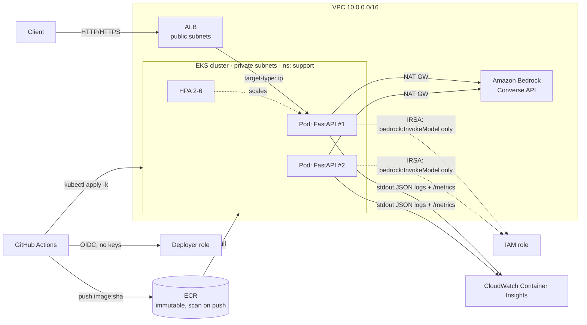

# AI Support Ticket Assistant (FastAPI · Amazon Bedrock · EKS)

`POST` a support ticket → get back **category, priority, summary and a suggested reply**, generated by an LLM on Amazon Bedrock. Runs on EKS behind an ALB, deployed by GitHub Actions with no static AWS keys.

## Architecture



**Request flow:** client → ALB → pod (`/v1/tickets/analyse`) → input validation → Bedrock `Converse` with a *forced tool call* (guarantees JSON matching our schema) → pydantic validation → response. The pod authenticates to Bedrock via **IRSA** (a service-account-bound IAM role), never with keys.

## Repo layout

| Path | Purpose |
|---|---|
| `app/` | FastAPI app (`main.py`), Bedrock client + mock (`llm.py`), schemas, config |
| `tests/` | pytest suite (no AWS needed) |
| `Dockerfile` | Multi-stage, non-root, slim image |
| `terraform/` | VPC, EKS, ECR, IRSA roles, ALB controller, GitHub OIDC role |
| `k8s/` | Kustomize: Deployment, Service, Ingress, HPA, PDB, NetworkPolicy, SA |
| `.github/workflows/` | `ci.yml` (lint/test/scan/tf validate), `deploy.yml` (build → ECR → EKS) |

## API

```bash
curl -X POST http://<alb-dns>/v1/tickets/analyse \
  -H 'content-type: application/json' -H 'x-api-key: <key>' \
  -d '{"subject":"Charged twice","body":"I was billed twice for March and need a refund.","customer_name":"Asha"}'
```
```json
{"category":"billing","priority":"high","summary":"...","suggested_response":"...","request_id":"...","model_id":"..."}
```
Other endpoints: `/healthz` (liveness), `/readyz` (readiness), `/docs` (OpenAPI).

## Run locally

```bash
python -m venv .venv && source .venv/bin/activate
pip install -r requirements-dev.txt
pytest -q

# offline, no AWS needed
LLM_MODE=mock uvicorn app.main:app --reload

# against real Bedrock (needs AWS creds + model access in the region)
AWS_REGION=us-east-1 BEDROCK_MODEL_ID=<model-or-inference-profile-id> uvicorn app.main:app

# container
docker build -t ticket-assistant . && docker run -p 8000:8000 -e LLM_MODE=mock ticket-assistant
```

## Deploy to AWS

**Prereqs:** AWS CLI, Terraform ≥ 1.6, kubectl, a GitHub repo, and **Bedrock model access enabled** for your chosen model (Bedrock console → Model access). Verify the model/inference-profile ID in the console; if you use a different region (e.g. `ap-south-1`) use the matching regional/global profile ID and set it in `k8s/configmap.yaml`.

```bash
# 1. Infrastructure (~15 min)
cd terraform
cp terraform.tfvars.example terraform.tfvars   # set github_repo (and create_github_oidc_provider=false if the provider exists)
terraform init && terraform apply

# 2. One-time bootstrap
$(terraform output -raw kubeconfig_command)
kubectl apply -f ../k8s/namespace.yaml
kubectl -n support create secret generic ticket-assistant-secrets --from-literal=api-key="$(openssl rand -hex 24)"

# 3. GitHub repo -> Settings -> Variables (Actions), from terraform outputs:
#    AWS_REGION, EKS_CLUSTER, ECR_REPOSITORY (ecr_repository_url), AWS_DEPLOY_ROLE_ARN (github_deployer_role_arn), APP_ROLE_ARN (app_role_arn)

# 4. Push to main -> deploy.yml builds, pushes, applies and waits for rollout
kubectl -n support get ingress ticket-assistant   # ALB hostname (takes ~2-3 min)
```
**Teardown:** `kubectl delete ingress -n support ticket-assistant` (so the ALB is removed), then `terraform destroy`. NAT gateway and nodes cost money while running.

## Key design decisions (talking points)

| Decision | Why | Alternative / trade-off |
|---|---|---|
| **Bedrock Converse API + forced tool call** | Model-agnostic API, structured output without brittle JSON parsing, data stays in AWS, IAM auth | Prompt-only JSON is less reliable; direct Anthropic API needs key management |
| **IRSA for pod→Bedrock** | Short-lived creds, scoped to one service account, no secrets | EKS Pod Identity is the newer, simpler option |
| **GitHub OIDC → AWS role** | No stored AWS keys; trust limited to `repo:<owner/repo>:ref:refs/heads/master` | Long-lived keys in secrets (rejected) |
| **EKS access entry scoped to `support` namespace** | CI can deploy the app only, not administer the cluster | Cluster-admin for CI (too broad) |
| **Nodes in private subnets, ALB in public** | Pods not directly internet-reachable | Single NAT = cost saving, but an AZ SPOF; VPC endpoints would remove NAT dependency for Bedrock |
| **ALB `target-type: ip`** | Skips NodePort/kube-proxy hop, pod-level health checks | `instance` mode is simpler but adds a hop |
| **Immutable ECR tags = git SHA** | Traceable, rollback-friendly, no `latest` ambiguity | |
| **Readiness does not call Bedrock** | Avoids cost and a Bedrock blip taking all pods out of service | Trade-off: a Bedrock outage surfaces as 502s, not unready pods |
| **Sync endpoint, 1 uvicorn worker per pod** | boto3 is blocking → threadpool; scale with replicas/HPA | async needs aioboto3 |
| **Kustomize** | Simple image-tag injection, no templating | Helm if multi-env packaging is needed |

## Security

- **IAM:** app role allows only `bedrock:InvokeModel` on Anthropic models/inference profiles; deployer role limited to ECR push + `eks:DescribeCluster`; OIDC trust pinned to repo + branch.
- **Container/pod:** non-root UID, read-only root FS, all capabilities dropped, no privilege escalation, seccomp `RuntimeDefault`, namespace enforces Pod Security `restricted`.
- **Network:** default-deny `NetworkPolicy`; ingress only from VPC on 8000; egress only DNS + 443. (Requires VPC CNI network policy — enabled in Terraform.)
- **Supply chain:** Trivy scan in CI, ECR scan-on-push, pinned dependencies, immutable tags.
- **App:** input size limits, optional `x-api-key` (constant-time compare, from a K8s Secret), ticket body **never logged** (PII), prompt-injection defence (untrusted-data framing, forced tool schema, output validated by pydantic, no tools/actions that can do harm).
- **Production hardening (not built, but would add):** ACM HTTPS + WAF + rate limiting or Cognito/JWT auth, Bedrock Guardrails (PII/topic filtering), VPC interface endpoints for Bedrock, restrict EKS public endpoint CIDRs, External Secrets/Secrets Manager with KMS envelope encryption, Kyverno/OPA policies.

## Monitoring & operations

- **Logs:** JSON to stdout → CloudWatch via the Container Insights add-on (`/aws/containerinsights/<cluster>/application`). Each log has a `request_id` (also returned in the `x-request-id` header).
- **Metrics:** Container Insights gives node/pod CPU & memory. Suggested alarms: 5xx rate, p95 latency, pod restarts, ALB unhealthy hosts, Bedrock `InvocationThrottles` (CloudWatch `AWS/Bedrock`).
- **Scaling:** HPA on CPU (2–6). Because the app is I/O bound on Bedrock, the real limit is usually **Bedrock quota/throttling**, not CPU. The client retries with adaptive backoff and returns `429` when throttled.

## Troubleshooting cheat sheet

| Symptom | Check |
|---|---|
| `502` from API, logs show `AccessDeniedException` | IRSA: `kubectl -n support describe sa ticket-assistant` has the role annotation? Pod env has `AWS_ROLE_ARN`/`AWS_WEB_IDENTITY_TOKEN_FILE`? Role policy resource ARNs match the model/inference profile? Model access enabled in Bedrock console? |
| `ValidationException` model ID | Wrong region/profile ID; some models require an inference profile (`us.`/`apac.`/`global.` prefix) |
| `429` | Bedrock throttling — request a quota increase, lower concurrency, cap HPA |
| Ingress has no ADDRESS | `kubectl -n kube-system logs deploy/aws-load-balancer-controller`; subnet tags `kubernetes.io/role/elb`; controller IRSA role |
| ALB targets unhealthy | `/healthz` reachable? NetworkPolicy allows VPC CIDR on 8000? Security groups? |
| Pods `Pending` | `kubectl describe pod` — node capacity, IP exhaustion, resource requests |
| `CrashLoopBackOff` / `ImagePullBackOff` | `kubectl logs --previous`; ECR repo URL, tag exists, node role can pull from ECR |
| Rollout stuck | `kubectl rollout status/history`; readiness probe failing; the workflow auto-runs `rollout undo` on failure |
| Pod can't reach Bedrock | NAT gateway/route tables, egress NetworkPolicy, DNS (UDP/TCP 53) |
| CI can't deploy | OIDC `sub` matches repo/branch? access entry exists? `aws sts get-caller-identity` in the job |

## Known limitations / next steps

Single NAT gateway; HTTP only in the demo; no persistence (stateless by design — add DynamoDB/SQS for audit trail or async processing at volume); no prompt/response evaluation harness; no multi-env promotion (dev → prod) or GitOps (Argo CD would be the next step); cost controls (token limits, caching of repeated tickets).
